<!-- Gerado por scripts/github-readme/build-readme.mjs (repo do portfólio). Edite lá e rode de novo. -->

<a href="https://curriculo-savio-exe.vercel.app"><picture><source media="(prefers-color-scheme: light)" srcset="assets/hero-light.svg"></picture></a>

  
  
  
  
  

<picture><source media="(prefers-color-scheme: light)" srcset="assets/win-01-light.svg"></picture>

Engenheiro de software construindo SaaS para transporte fluvial e gestão portuária na Amazônia. Faço parte da equipe que projetou e desenvolve um ecossistema que conecta venda de passagens, emissão fiscal (BP-e/SEFAZ), pagamentos, gestão portuária, controle financeiro e controle de acesso físico, usado por empresas de navegação, agências, portos e passageiros. Trabalho na W3 Companhia desde 2023 e, em paralelo, atendo projetos freelance de gestão financeira e de educação com IA. [Saiba mais](https://w3companhia.com/blog/yjara-viagens-inovacao-sustentavel-e-inclusiva-no-transporte-fluvial-amazonico-com-o-apoio-do-ciat)

<picture><source media="(prefers-color-scheme: light)" srcset="assets/win-02-light.svg"></picture>

<table>
<tr>
<td width="50%" valign="top">

<b>▸ TechRios</b> 
ERP SaaS de transporte fluvial

ERP SaaS para empresas de navegação: empresas, agências, viagens, trechos, relatórios e emissão fiscal (BP-e/SEFAZ), com IA de assistência à venda e servidor MCP para consultas em linguagem natural. +36,7% em movimentações vs. 2024.

<a href="https://techrios.online/"><code>[ abrir ↗ ]</code></a> <a href="https://curriculo-savio-exe.vercel.app/projetos/techrios/"><code>[ detalhes ]</code></a>
</td>
<td width="50%" valign="top">

<b>▸ Yjara Viagens</b> 
E-commerce de passagens fluviais

E-commerce de passagens fluviais e rodoviárias sobre a API do TechRios. Arquitetei toda a API, incluindo pagamentos online. Go-live em jun/2025, com +44% no volume transacionado.

<a href="https://yjaraviagens.com/"><code>[ abrir ↗ ]</code></a> <a href="https://curriculo-savio-exe.vercel.app/projetos/yjara-viagens/"><code>[ detalhes ]</code></a>
</td>
</tr>
<tr>
<td width="50%" valign="top">

<b>▸ Agente Águia</b> 
Estudo para concursos com IA

Plataforma de estudo para concursos com IA, com banco de questões e provas, comentários pedagógicos gerados por LLM e um chat que faz busca semântica, cria flashcards e resume conteúdos.

<a href="https://agenteaguia.omentorconcursos.com.br/"><code>[ abrir ↗ ]</code></a> <a href="https://curriculo-savio-exe.vercel.app/projetos/agente-aguia/"><code>[ detalhes ]</code></a>
</td>
<td width="50%" valign="top">

<b>▸ O Mentor App</b> 
Gestão de rotina e estudos para concurseiros

Plataforma de mentoria para concurseiros, integrada ao Agente Águia e lançada em novembro de 2026 para quase 8 mil alunos. Atuei no backend em Laravel e no frontend em Next.js, no onboarding, no planejamento de rotina e no ciclo de estudos.

<a href="https://omentorconcursos.com.br"><code>[ abrir ↗ ]</code></a> <a href="https://curriculo-savio-exe.vercel.app/projetos/o-mentor-app/"><code>[ detalhes ]</code></a>
</td>
</tr>
<tr>
<td width="50%" valign="top">

<b>▸ River FIAM</b> 
Gestão financeira de projetos da UFOPA

Sistema de gestão financeira dos projetos de pesquisa da fundação de apoio da UFOPA, do orçamento à prestação de contas. Inclui a Iara, a conferência de documentos com IA e a conciliação integrada ao Banco do Brasil e ao Sicredi.

<a href="https://app.portalfiam.org/transparency-portal"><code>[ abrir ↗ ]</code></a> <a href="https://curriculo-savio-exe.vercel.app/projetos/river-fiam/"><code>[ detalhes ]</code></a>
</td>
<td width="50%" valign="top">

<b>▸ Navegante</b> 
Gestão portuária e fluvial da Prefeitura de Santarém

Plataforma multi-tenant para prefeituras gerirem o transporte fluvial e os portos: armadores, embarcações, atracações, licenças, vistorias e autuações. Em uso em Santarém, integrada ao Porto Fácil.

<a href="https://curriculo-savio-exe.vercel.app/projetos/navegante/"><code>[ detalhes ]</code></a>
</td>
</tr>
<tr>
<td width="50%" valign="top">

<b>▸ Porto Fácil</b> 
API de gestão portuária

API REST de gestão portuária consumida por múltiplos sistemas e por catracas físicas de controle de acesso, que reduziu a conciliação de taxas de horas para minutos.

<a href="https://portofacil.online/"><code>[ abrir ↗ ]</code></a> <a href="https://curriculo-savio-exe.vercel.app/projetos/porto-facil/"><code>[ detalhes ]</code></a>
</td>
<td width="50%" valign="top">

<b>▸ W3Zap</b> 
CRM omnichannel de atendimento com IA

CRM de atendimento por WhatsApp, Instagram e Messenger, construído sobre o Ticketz e adaptado às operações da W3, com API oficial do WhatsApp, campanhas segmentadas, agentes de IA nas automações e chamadas de voz.

<a href="https://app.w3zap.net/"><code>[ abrir ↗ ]</code></a> <a href="https://curriculo-savio-exe.vercel.app/projetos/w3zap/"><code>[ detalhes ]</code></a>
</td>
</tr>
<tr>
<td width="50%" valign="top">

<b>▸ RIBBA</b> 
Rede de Inovação da Bioeconomia do Baixo Amazonas

Plataforma institucional da Rede de Inovação da Bioeconomia do Baixo Amazonas, que conecta empreendedores, pesquisadores, instituições e comunidade, com apresentação dos parceiros e formulário de adesão.

<a href="https://rederibba.org"><code>[ abrir ↗ ]</code></a> <a href="https://curriculo-savio-exe.vercel.app/projetos/ribba/"><code>[ detalhes ]</code></a>
</td>
<td width="50%" valign="top">

<b>▸ BjMarmitaria</b> 
Pedidos de refeições universitárias

Sistema de pedidos de marmitas para os campi da UFOPA, com cardápio semanal por campus, prazo para pedidos de almoço e janta, opção vegetariana e pagamento via PIX.

<a href="https://bjmarmitaria.com"><code>[ abrir ↗ ]</code></a> <a href="https://curriculo-savio-exe.vercel.app/projetos/bjmarmitaria/"><code>[ detalhes ]</code></a>
</td>
</tr>
</table>

<picture><source media="(prefers-color-scheme: light)" srcset="assets/win-03-light.svg"></picture>

<b><code>principal</code></b>  
<picture><source media="(prefers-color-scheme: light)" srcset="https://skillicons.dev/icons?i=php,laravel,vue,mysql,postgres,react,nextjs&theme=light"></picture> + REST APIs
  

<b><code>trabalho regular</code></b>  
<picture><source media="(prefers-color-scheme: light)" srcset="https://skillicons.dev/icons?i=docker,linux,git,nodejs,ts,redis,supabase&theme=light"></picture> + MCP · RAG
  

<b><code>experiência com</code></b>  
<picture><source media="(prefers-color-scheme: light)" srcset="https://skillicons.dev/icons?i=java,spring,py,firebase&theme=light"></picture> + Neo4j

  

no trabalho uso o stack acima · no tempo livre gosto de explorar <b>Java</b> e <b>Kotlin</b>

<picture><source media="(prefers-color-scheme: light)" srcset="assets/win-04-light.svg"></picture>

- **[DriftGuard](https://github.com/saviogodinho2002/driftguard)** · Pacote Laravel com IA Pacote open source publicado no Packagist que mantém a documentação dos models Eloquent sincronizada com o código, extraindo a estrutura por reflection e usando IA só para sugerir descrições, aplicadas após revisão humana.
- **[Knob & Switch Computer](https://github.com/saviogodinho2002/copia-The-Knob-e-Switch-Computer)** · Simulador em JavaScript Simulador em HTML e JavaScript do Knob & Switch Computer, com memória, registradores, barramentos e ALU e execução contínua ou passo a passo.
- **[Corta Fácil](https://github.com/saviogodinho2002/corta-facil)** · Editor de vídeo em Python Interface gráfica em Python que corta vídeos em partes e junta os trechos num único arquivo, usando o FFmpeg sem perder qualidade.
- **[Analisador de Expressões](https://github.com/saviogodinho2002/Analisador-de-expressao)** · Kotlin Interpreta expressões matemáticas usando só recursão e regex, respeitando a precedência e corrigindo parênteses desbalanceados e sinais repetidos.
- **[Calculadora em Brainfuck](https://github.com/saviogodinho2002/calculadora-brainfuck)** · Linguagem esotérica Calculadora em Brainfuck que lê dois números de um dígito e um operador de soma ou subtração e devolve o resultado.
- **[Vizinho Mais Próximo](https://github.com/saviogodinho2002/vizinho-mais-proximo-grafos)** · Algoritmo em C Heurística Nearest-Neighbor para o Problema do Caixeiro Viajante em grafos completos ponderados, testando cada vértice como ponto de partida e exibindo o caminho e a distância total.

<picture><source media="(prefers-color-scheme: light)" srcset="assets/win-05-light.svg"></picture>

- **Mestrado em Computação** · Universidade Federal do Oeste do Pará <code>2026 – atual</code> Pesquisa em segurança de integrações de sistemas com LLMs.
- **Bacharelado em Ciência da Computação** · Universidade Federal do Oeste do Pará <code>2020 – 2024</code>

<picture><source media="(prefers-color-scheme: light)" srcset="assets/win-06-light.svg"></picture>

  <picture><source media="(prefers-color-scheme: light)" srcset="https://github-readme-streak-stats-savio.vercel.app/?user=saviogodinho2002&count_private=true&border_radius=0&background=f4f1e4&border=8fae97&stroke=8fae97&ring=9a5b00&fire=9a5b00&currStreakNum=1d4d2b&sideNums=1d4d2b&currStreakLabel=9a5b00&sideLabels=4a6b52&dates=4a6b52"></picture>
  <picture><source media="(prefers-color-scheme: light)" srcset="https://github-readme-stats-drab-seven-40.vercel.app/api?username=saviogodinho2002&count_private=true&show_icons=true&rank_icon=github&border_radius=0&bg_color=f4f1e4&title_color=9a5b00&text_color=1d4d2b&icon_color=1d4d2b&border_color=8fae97&ring_color=9a5b00"></picture>

<a href="https://curriculo-savio-exe.vercel.app"><picture><source media="(prefers-color-scheme: light)" srcset="assets/statusbar-light.svg"></picture></a>
